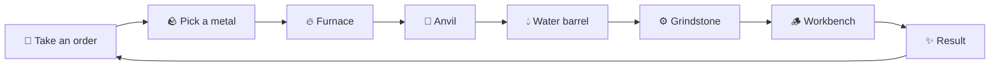

<div align="center">

# ⚒️ Tiny Blacksmith

**A cozy low-poly blacksmith sim. Forge weapons, serve the townsfolk, and grow a tiny smithy at the edge of a living city.**


</div>

---

## 🔥 About the game

You are the blacksmith of a small workshop. Customers come to your table and tell you what they need: a fencer wants a light, sharp blade, a dwarf mercenary wants something that never breaks, a cook just needs a good knife. You take the order, light the furnace, and craft the weapon yourself, one hammer hit at a time.

Every weapon you make is unique. It has its own stats, its own ID number and its own story. Sell it and it may come back years later for repairs, or show up on the belt of someone walking through town.

## 🗡️ The forging loop

Each weapon goes through a chain of hands-on mini-games:



| Station | What you do |
|---|---|
| 🔥 **Furnace** | Hold the **right mouse button** to keep the fire inside your catcher bar. The better you track the heat, the more anvil hits you earn. |
| 🔨 **Anvil** | Click glowing points before they vanish. **Red** adds Durability, **yellow** adds Balance, and you can only take one per round. |
| 💧 **Water barrel** | Hold **Space** to quench and release at the right moment. A bad quench can **crack** the blade! |
| ⚙️ **Grindstone** | Press **Space** to spin the wheel, then hold **LMB** to sharpen. Every touch adds Sharpness but costs Durability. |
| 🪵 **Workbench** | Drag the guard, grip and pommel into their outlines (mouse wheel or **Q/E** to rotate). A closer fit gives a better weapon. |

## ✨ Features

- **5 weapon types:** sword, dagger, sickle, spear and hammer, each with its own forging feel and stat weights
- **3 metals:** Copper, Iron and Steel, with different difficulty, price and stat limits. Iron and Steel are unlocked by a special traveling trader.
- **3 races:** Humans, Elves and Dwarves, each with their own tastes, greetings and favorite weapons
- **Living customers:** every NPC has a name, age, traits, a backstory, life events and memories of you
- **Order book:** accept orders, reserve weapons for them, and meet deadlines. Rush jobs and multi-weapon contracts pay extra.
- **Hidden judging:** customers describe what they want in their own words, not in numbers, and judge the weapon when they pick it up
- **Weapon history:** every weapon you sell is tracked forever and can come back for repairs
- **Economy and reputation:** earn gold, build a reputation, buy ore from the Material Order Book, and unlock better customers
- **Game clock:** forging takes time, the day runs from dawn to night, and you end the day at your house
- **Living city:** a crowd that walks a real street graph, guards on patrol, benches, a river with bridges, a castle on the hill and city events
- **Day/night and seasons:** a moving sun and moon, lanterns at night, rain, snow and seasonal trees
- **Journal:** a chronicle of your workshop, your customers and your best weapons
- **Save system** and a full **main menu** with settings

## 🎮 Controls

| Key | Action |
|---|---|
| **A / D** | Look around the workshop (forge, table, storage, house) |
| **F** | Talk to the customer |
| **E** | Interact (journal, order book, delivery crate) |
| **Enter** | Head to the forge |
| **Mouse** | Mini-games (see the station table above) |
| **Esc** | Save and go to the main menu |

## 🛠️ Built with

- **Unity 6** (6000.6.2f1) with the **Universal Render Pipeline**
- **New Input System**
- **Blender** for the environment library (houses, landmarks, trees and props, built from Python scripts in `BlenderSource/scripts`)
- Procedural low-poly meshes and generated NPC animations, made in C#

## 📁 Project structure

```
Assets/
├── Scenes/            MainMenu.unity, Prototype1.unity (the game)
├── Scripts/           Gameplay code (stations, customers, economy, city life, save system…)
│   ├── Npc/           Skinned low-poly characters
│   ├── Time/          Game clock
│   └── World/         World director and city events
├── Editor/            Scene builders, test tools and playtests
├── Models/            Furnace, anvil, barrel and grindstone models
└── TinyBlacksmith/    Environment library (prefabs, materials, FBX)
BlenderSource/         Blender scripts and .blend source files
```

## ▶️ How to open it

1. Install **Unity Hub** and **Unity 6000.6.2f1**.
2. Clone or download this repository.
3. In Unity Hub, click **Add → Add project from disk** and pick the folder.
4. Open `Assets/Scenes/MainMenu.unity` and press **Play** ▶️

> The first time you open the project, Unity needs a few minutes to import everything.

## 👥 Credits

Made by **StroDan** as a first game project.

Contributor: **Claude** (Anthropic), who helped with code, tools and testing.

---

<div align="center">

*Heat. Hammer. Quench. Repeat.* ⚒️

</div>
